## 📱 Demo de la aplicación

<table align="center">
  <tr>
    <td align="center">
      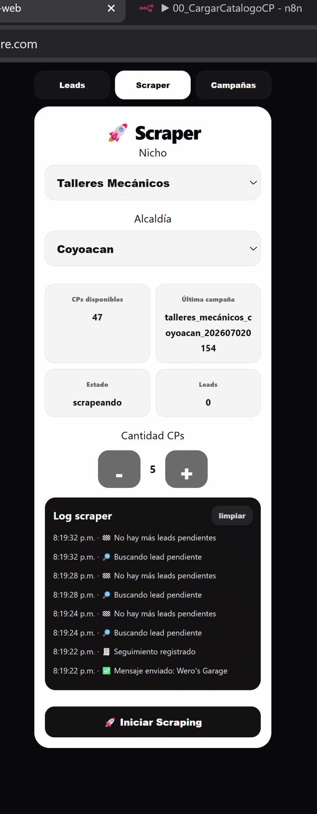 
      <b>Crear campaña</b>
    </td>
    <td width="30"></td>
    <td align="center">
      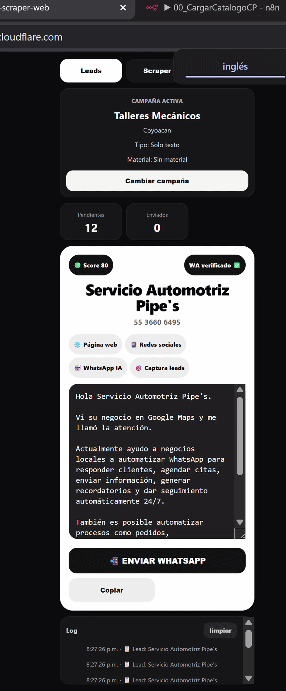 
      <b>Dashboard en tiempo real</b>
    </td>
  </tr>
</table>

# Prospector-Scraper

## Arranque local en Windows

1. Copia `launcher.local.ps1.example` a `launcher.local.ps1` y configura las rutas de PocketBase y cloudflared para tu equipo.
2. Copia `web/.env.example` a `web/.env` y configura solo URLs públicas. Las variables `VITE_*` se incluyen en el navegador; nunca pongas claves o contraseñas allí.
3. Para una instalación nueva de WAHA, copia `.env.example` a `.env`, configura las credenciales privadas y las rutas absolutas de sesiones y videos. Después ejecuta `docker compose -p waha-test -f docker-compose.waha.yml up -d waha`. Las sesiones se guardan en `WAHA_SESSIONS_DIR`.
4. Ejecuta `ABRIR_PROSPECTOR_SCRAPER.bat`. También admite `--start` y `--status` para usarlo sin menú. WAHA se publica en `http://localhost:3001` porque el puerto 3000 está ocupado por Gotenberg en la instalación actual.

Para abrir la aplicación en el celular, usa la URL **React celular** que imprime la opción **1. Iniciar todo** del `.bat`, o consulta la opción **3. Ver URLs para celular**. El frontend llama a los dos webhooks necesarios de n8n por esa misma URL; el editor de n8n y el dashboard de WAHA permanecen locales. PocketBase usa su propio túnel HTTPS. Los túneles rápidos de Cloudflare pueden recibir URLs nuevas al reiniciarse: consulta de nuevo la opción 3 después de cada arranque.

En la instalación existente, el Compose de WAHA está fuera de este repositorio y conserva su propio `.env` y directorio de sesiones. El launcher reutiliza el contenedor `waha-test-waha-1`. Desde el contenedor n8n, WAHA se alcanza en `http://host.docker.internal:3001`; el puerto 3000 corresponde a Gotenberg.

La sesión de WhatsApp de este proyecto se llama `prospector-scraper`. La instancia local de n8n guarda la clave WAHA en una credencial cifrada de tipo **Header Auth** con la cabecera `X-Api-Key`. Las copias publicadas de los workflows se actualizaron junto con la rotación de la clave. Los JSON de `n8n/` son exportaciones portables: usan `$env.WAHA_API_KEY` y requieren configurar esa variable en una nueva instancia o sustituirla por una credencial Header Auth propia. Nunca pongas esta clave en `web/.env` ni en un archivo versionado.

## Prueba manual de un solo mensaje

En la instancia local de n8n existe el workflow inactivo `07_PruebaUnMensaje_WAHA`. No modifica leads ni campañas. El JSON de `n8n/` es una plantilla sin ID de credencial; tras importarlo en otra instancia, asigna una credencial Header Auth con la cabecera `X-Api-Key` a sus dos nodos HTTP.

1. Vincula la sesión `prospector-scraper` en WAHA y comprueba que su estado sea `WORKING`.
2. Abre `07_PruebaUnMensaje_WAHA` en n8n y edita `DatosPrueba`: sustituye `PON_AQUI_TU_NUMERO` por tu número de WhatsApp y revisa el texto de prueba.
3. Pulsa **Execute workflow** una sola vez. El flujo valida la sesión antes de llamar una vez a `/api/sendText`. Revisa el resultado del nodo `Enviar un solo mensaje` y la recepción en tu teléfono.

El workflow publicado `06_EnviarLeadManual` tiene habilitado el envío de texto. Cuando la campaña no tiene material, pasa directamente a `/api/sendText` y no recorre el envío de video. Conserva la normalización de teléfono comprobada con `07_PruebaUnMensaje_WAHA` y exige un identificador de mensaje en la respuesta de WAHA antes de marcar el lead como enviado.

Para probar el botón desde la aplicación en la instancia local preparada, abre **Leads**, pulsa **Cambiar campaña** y selecciona **Prueba manual WhatsApp · Solo prueba**. Comprueba que se muestre **Contacto de prueba propio**, **Solo texto** y **Sin material**. Entonces pulsa **ENVIAR WHATSAPP** una sola vez. El contacto de prueba vive en PocketBase, separado de las campañas de prospectos; su número no forma parte de este repositorio.

## Vista general de workflows

  <a href="docs/1.jpg">
    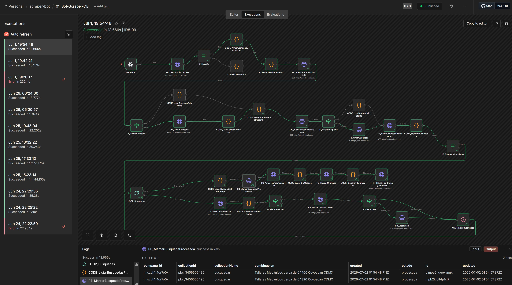
  </a>
  <a href="docs/2.jpg">
    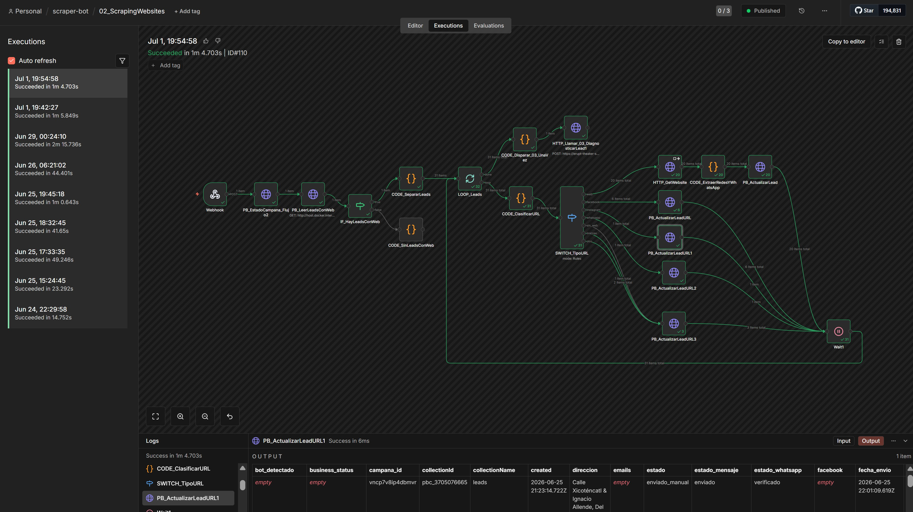
  </a>

  <a href="docs/3.jpg">
    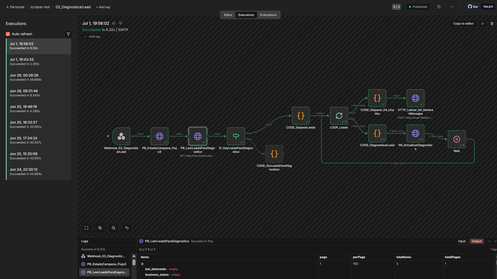
  </a>
  <a href="docs/4.jpg">
    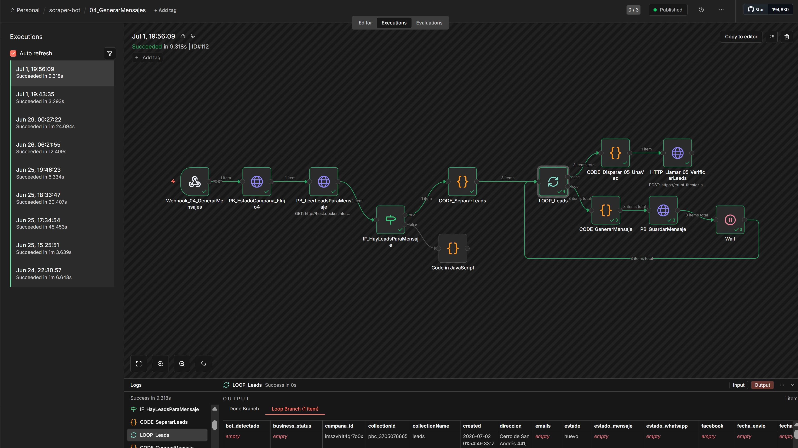
  </a>

  <a href="docs/5.jpg">
    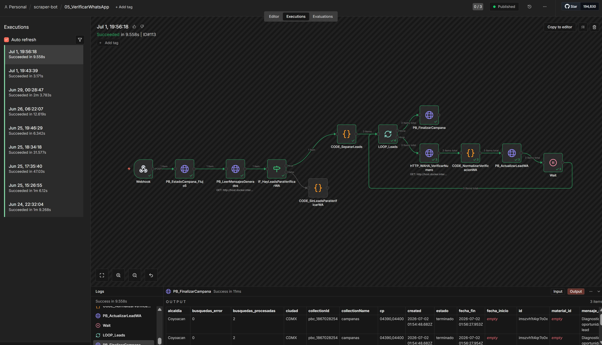
  </a>
  <a href="docs/6.jpg">
    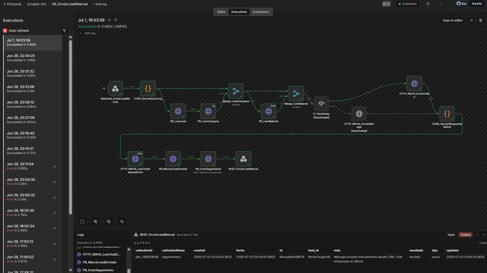
  </a>

---

## Flujo General

## Flujo General

1. Usuario crea campaña
2. Se generan lotes de códigos postales
3. Scraper obtiene negocios
4. Se extraen teléfonos
5. Se detecta WhatsApp
6. Se generan mensajes personalizados
7. Se envían mensajes
8. Se registran respuestas
9. Agente IA continúa conversación
10. Dashboard muestra métricas

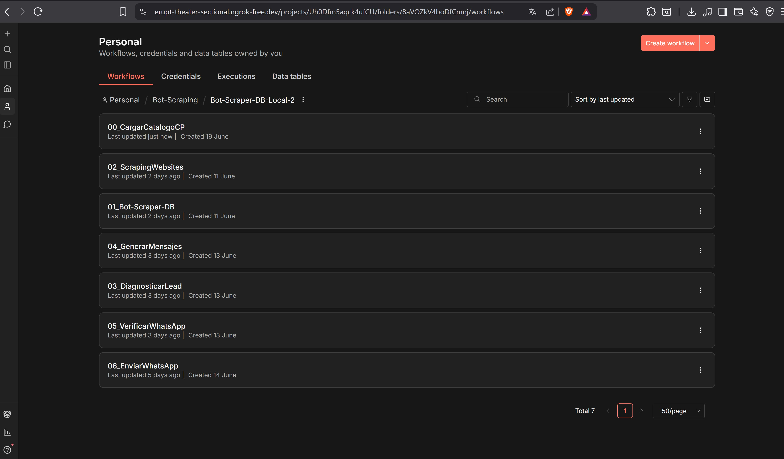
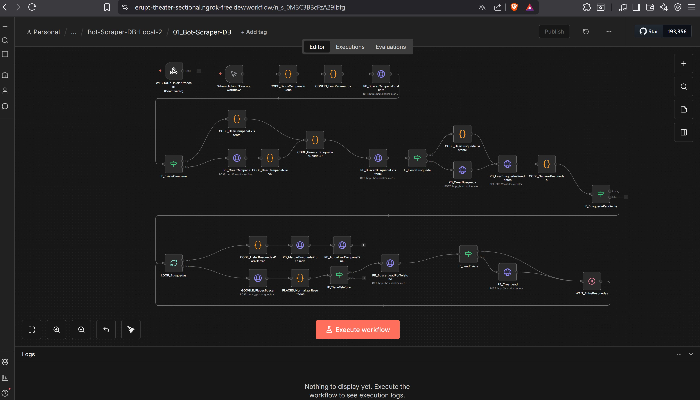
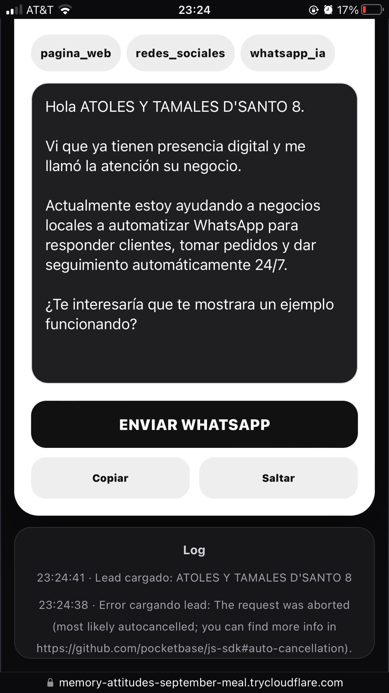
